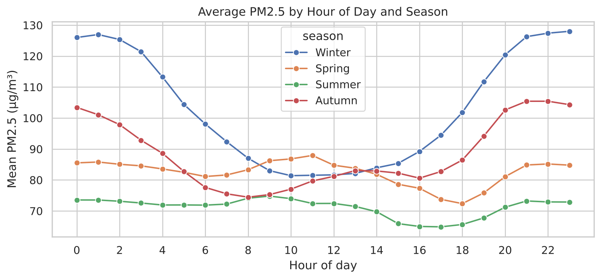
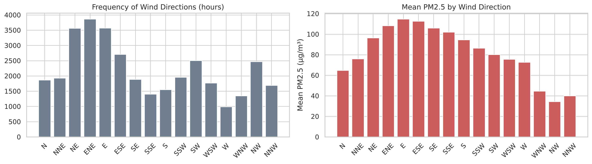
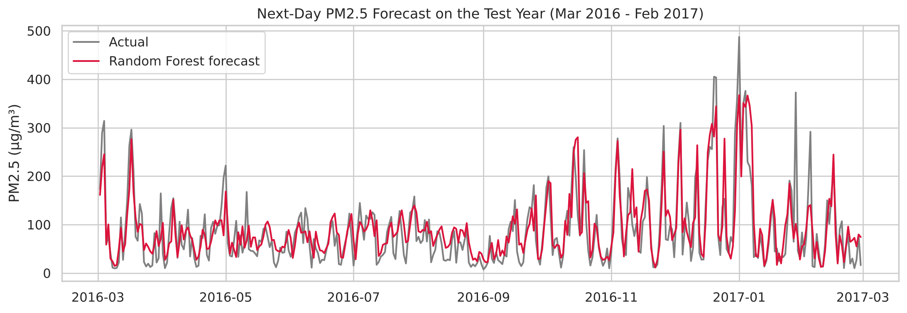

# Beijing Air Quality: EDA and Next-Day PM2.5 Forecasting

Exploratory data analysis of four years of hourly air-quality and weather data from the **Dongsi** monitoring station in central Beijing (March 2013 – February 2017), followed by a model that forecasts **tomorrow's average PM2.5**.

EDA Theory Project, Exploratory Data Analysis (BCSE331P), VIT Vellore. Harshit Arora (23BDS0002).

## Questions

1. When does PM2.5 pollution get high (season, hour of day), and under what weather conditions?
2. Can that knowledge be used to forecast the next day's PM2.5?

## Dataset

[Beijing Multi-Site Air-Quality Data Set](https://archive.ics.uci.edu/dataset/501/beijing+multi+site+air+quality+data) (Song Chen, 2017; also on Kaggle), Dongsi station file only: 35,064 hourly rows, 18 columns.

| Group | Columns |
|---|---|
| Time | `year`, `month`, `day`, `hour` |
| Pollutants (µg/m³) | `PM2.5`, `PM10`, `SO2`, `NO2`, `CO`, `O3` |
| Weather | `TEMP`, `PRES`, `DEWP` (dew point), `RAIN`, `wd` (wind direction), `WSPM` (wind speed, m/s) |

The CSV is included in [`data/`](data/). The dataset is released under CC BY 4.0.

## What the notebook does

| Step | Techniques |
|---|---|
| Data preparation | Build a datetime index, check for duplicate rows and missing hours |
| Missing values | Count, percentage and **longest consecutive gap** per column; time-based interpolation for numeric columns, forward fill for wind direction |
| Outliers | Box plots and the IQR rule; real haze episodes kept, physically impossible ozone readings (2 → 1071 µg/m³ at night) set to missing |
| Univariate | Summary statistics, skewness and kurtosis, PM2.5 distribution, days per China AQI level |
| Bivariate / multivariate | PM2.5 by month, season, hour and wind direction; correlation heatmap; dew point vs PM2.5 coloured by wind speed |
| Time series | 30-day rolling mean, seasonal decomposition, ACF / PACF |
| Forecasting | Lag and rolling features + next-day weather; chronological train/test split; baseline vs Linear Regression vs Random Forest |

## Key findings

- PM2.5 is strongly right-skewed (mean 86, median 61 µg/m³), and **43.5% of days** exceed China's 24-hour standard of 75 µg/m³.
- **Winter is the worst season**, and winter pollution peaks around **11 pm**, when a shallow, stable night-time air layer traps heating and traffic emissions.
- **Wind direction matters a lot**: easterly winds bring more than 3× the PM2.5 of north-westerly winds, which carry clean air from the Mongolian plateau.
- **Calm days are polluted days**: 25 of the 28 days above 300 µg/m³ had an average wind speed below 1.5 m/s.
- Daily PM2.5 has a short memory: lag-1 autocorrelation is 0.55 and it fades within about three days.

<p>
  
  
</p>

## Forecasting results

The target is tomorrow's daily mean PM2.5. The model is trained on March 2013 – February 2016 (1,090 days) and tested on the final year, March 2016 – February 2017 (364 days).

| Model | MAE | RMSE | R² |
|---|---:|---:|---:|
| Baseline: tomorrow = today | 47.9 | 70.4 | 0.175 |
| Linear Regression | 37.0 | 52.0 | 0.549 |
| **Random Forest** | **31.2** | **43.6** | **0.684** |
| Random Forest without weather features | 44.4 | 63.1 | 0.337 |

- The most important features are today's PM2.5 and tomorrow's wind speed, which matches what the EDA found.
- Used as a warning for days above 75 µg/m³, the model correctly flags **137 of 161 polluted days (85%)**.
- The model uses the observed next-day weather as a stand-in for a weather forecast, so real-world errors would be somewhat larger.

<p>
  
</p>

## Repository structure

```
├── EDA_Theory_Project.ipynb   # full analysis and model (executed, with outputs)
├── data/
│   └── PRSA_Data_Dongsi_20130301-20170228.csv
├── report/
│   └── EDA_Theory_Project.pdf # written project report
├── images/                    # figures used in this README
└── requirements.txt
```

## How to run

```bash
pip install -r requirements.txt
jupyter lab EDA_Theory_Project.ipynb
```

Run the cells from top to bottom. The whole notebook takes about a minute.
